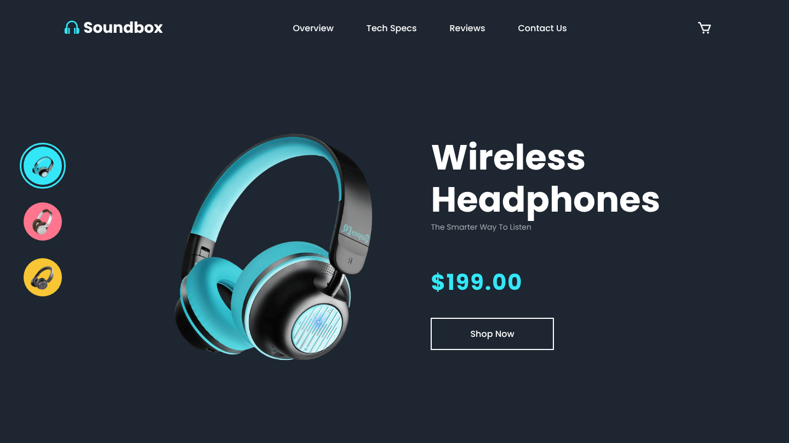
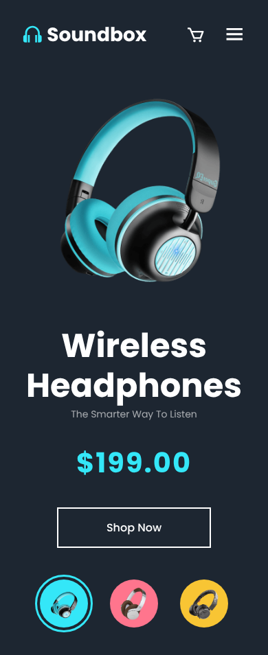

# 🎧 Soundbox — Landing Page de Fones de Ouvido

Landing page de e-commerce para uma loja fictícia de fones de ouvido sem fio, feita com **HTML, CSS e JavaScript puro**.

🔗 **[Ver o site no ar](https://oliversoriano.github.io/ecommerce-headphones/)**



## ✨ Funcionalidades

- **Troca de modelo**: ao clicar em uma miniatura, a imagem principal muda e a **cor de destaque da página** (logo e preço) acompanha a cor do produto
- Indicação visual do modelo selecionado
- **Layout responsivo** para desktop, tablet e celular
- **Menu mobile** que abre e fecha, com o ícone alternando entre ☰ e ✕
- Animações de hover nos ícones, links e botões



## 🛠️ Tecnologias


- CSS Grid e Flexbox
- Variáveis CSS (`--main-color`) alteradas via JavaScript
- Media queries para responsividade
- [Boxicons](https://boxicons.com/) e fonte Poppins (Google Fonts)

## 🚀 Como rodar

Não precisa instalar nada. Clone o repositório e abra o `index.html` no navegador:

```bash
git clone https://github.com/oliversoriano/ecommerce-headphones.git
```

## 📁 Estrutura

```
ecommerce-headphones/
├── index.html   # Estrutura da página
├── style.css    # Estilos e responsividade
├── script.js    # Troca de modelo e menu mobile
├── img/         # Imagens dos produtos
└── docs/        # Capturas de tela do README
```

## 👤 Autor

**[Oliver Soriano](https://github.com/oliversoriano)**
